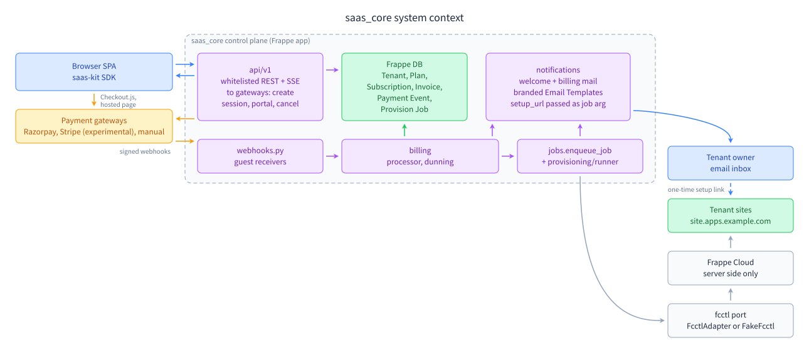

# saas_core

> **ALPHA. Early, bleeding edge, expect breaking changes.**
> Package version `0.1.0a1`, HTTP API `2.0.0-alpha.1`. Endpoints, DocTypes, site_config keys and error codes
> may change between alpha releases without a migration path.
> **Run it on test-mode payment keys only** (`rzp_test_*`). Features that have not been exercised against a real
> deployment are **experimental and off by default**; see [Verified vs experimental](#verified-vs-experimental).

saas_core is a Frappe v16 app that acts as a **SaaS control plane**: it lets customers sign up, pick a plan, pay, and get
their own isolated Frappe site, created for them automatically on [Frappe Cloud](https://frappecloud.com). You run it
on one "control plane" site; each customer then gets a separate "tenant" site.

It handles:

- signup, login, password reset and a configurable signup gate (`closed`, `invite`, `allowlist`, `open`)
- plans and templates (what a new tenant site contains)
- Razorpay checkout and webhooks (Razorpay in `order` mode is the verified gateway)
- provisioning tenant sites on Frappe Cloud with [`fcctl`](https://github.com/tridz-open/fcctl), restoring from a golden backup
- billing: monthly in advance, whole-day pro-rata cancel with refund, plan upgrades
- beta-access invites (an allowlist plus branded invite email)
- branded transactional email
- an admin API and a versioned OpenAPI v1 contract ([openapi/v1.yaml](openapi/v1.yaml))

## Architecture in brief

- **Frontends talk only to the saas_core HTTP API.** Gateways call back into saas_core webhooks. Frappe Cloud is reached
  only from the server, through the `fcctl` port.
- **Pay then provision:** checkout creates a pending Tenant; the gateway callback or webhook is stored once as a Payment
  Event (`<gateway>:<event_id>`); the processor activates the Subscription; the first success enqueues a `provision`
  Provision Job that drives `fcctl` and emails the owner a one-time setup link. Jobs are auditable and resume-safe.
- **Related repos:**
  - SDK (TypeScript client for this API): [tridz-open/frappe-saaskit-sdk](https://github.com/tridz-open/frappe-saaskit-sdk)
  - Starter (a customer-facing app built on the SDK): [tridz-open/frappe-saaskit-starter](https://github.com/tridz-open/frappe-saaskit-starter)
  - Provisioning engine: [tridz-open/fcctl](https://github.com/tridz-open/fcctl)
- Diagrams and module contract: [docs/ARCHITECTURE.md](docs/ARCHITECTURE.md) and [ARCHITECTURE.md](ARCHITECTURE.md).



## Install on a bench

```bash
bench get-app https://github.com/tridz-dev/saas_core
bench --site <site> install-app saas_core
bench --site <site> migrate
```

Install creates the roles `SaaS Admin`, `SaaS Customer` and `SaaS Platform Worker`. To deploy to a Frappe Cloud
control-plane site instead, follow [DEPLOY.md](DEPLOY.md).

### Required site_config keys

Set each with `bench --site <site> set-config <key> <value>`.

| Key | Purpose |
|---|---|
| `saas_core_razorpay_key_id`, `saas_core_razorpay_key_secret`, `saas_core_razorpay_webhook_secret` | Razorpay **test** keys (`rzp_test_*`), read once by the `bootstrap_gateway` admin op to create the Gateway Account. Blank them afterwards |
| `saas_smtp_host`, `saas_smtp_port`, `saas_smtp_user`, `saas_smtp_password` (optional `saas_smtp_from`) | Outgoing mail; the `setup_email` admin op builds the Email Account from these |
| `saas_core_fc_team`, `saas_core_fc_server` | Frappe Cloud team and default server (needed for real provisioning) |
| `saas_core_session_key` | Fernet key that encrypts the stored Frappe Cloud login session |
| `saas_core_brand`, `saas_core_brand_color`, `saas_core_logo_url`, `saas_core_support_email` | Branding used in emails |
| `saas_core_site_domain` | Optional domain suffix for tenant sites (unset = Frappe Cloud's default domain) |
| `saas_core_signup_mode` | `closed` (default), `invite`, `allowlist`, `open` |
| `saas_core_fake_fcctl` | Truthy = in-memory fake instead of Frappe Cloud. Use for local trials and tests |

The full list (re-login, backups, capacity, URLs, email template overrides) is in the site_config reference in
[docs/STATUS.md](docs/STATUS.md).

### Gateway Account (order mode)

Create a **Gateway Account** (via the `bootstrap_gateway` op, or by hand in the desk) with `gateway = razorpay`,
`mode = test`, `enabled`, `key_id`, `key_secret`, `webhook_secret`, and `checkout_mode = order` (the verified mode).
Point the Razorpay webhook at `https://<site>/api/method/saas_core.webhooks.razorpay`. Signatures are verified with
the account's `webhook_secret` and duplicate events are ignored.

## Templates and recipes

A **Template** says what a new tenant site is: which apps, which golden backup to restore, which hooks to run, and how to
check it came up healthy. Full field reference and examples: **[docs/TEMPLATES.md](docs/TEMPLATES.md)**.

- **Golden-backup templates:** `backup_source` points at a Frappe Cloud site backup or at a backup in object storage
  (sha256-verified parts). The new site is restored from it instead of installed from scratch.
- **Hooks:** an ordered list of `{name, version, args}` run after restore. `core.*` hooks are built in to fcctl; other hooks
  come from a registered recipe (`saas_core.recipes.registry`). End every template with `core.scheduler_resume` and
  `core.maintenance_off`, or the site stays at 503.
- **`site_admin`:** tick it when a recipe hook needs administrator access to the new site (`ctx.site_admin`).
- **`is_public`:** defaults to off, and checkout rejects templates that are not public. Tick it for any template a public Plan uses.
- **Health checks:** after provisioning, each `{name, path, expect}` entry is requested over HTTPS and retried
  (`saas_core_fc_health_attempts` x `saas_core_fc_health_delay`, default 12 x 10 s).

## Billing policy

- **Monthly, in advance.** Customers pay for the period up front.
- **Cancel:** the site stays active through the end of the current day in IST (Asia/Kolkata). Days used count in full,
  including today; unused whole days are refunded **pro rata** to the original payment method.
  Refunds round down, charges round up.
- **Plan upgrade** is charged by payment link for the difference; the new plan starts at the next IST day.
- **No tax and no invoices without ERPNext:** saas_core issues **receipts** only. `invoices.pdf` generates no PDF; it redirects to the
  gateway-hosted payment page when one exists.

## Verified vs experimental

"Verified" means exercised against a real deployment (Razorpay test mode, Frappe Cloud, real SMTP). Everything else is
unit-tested against stubs only. This table mirrors [docs/STATUS.md](docs/STATUS.md), which is authoritative.

| Area | Status |
|---|---|
| Signup, login, logout, password reset | Verified |
| Beta-access allowlist and invites | Verified |
| Branded transactional email over SMTP | Verified (tenant-setup and beta-invite mails; billing mails tested via templates only) |
| Razorpay order-mode checkout, payment capture, webhooks | Verified |
| Provisioning on Frappe Cloud from a golden backup | Verified |
| Cancel with day-based pro-rata refund | Verified |
| Plan upgrade | Verified |
| Template validation, daily tenant backups, unattended FC re-login | Verified |
| Razorpay subscription mode (`razorpay_subscription`) | Experimental |
| Dunning, expiry sweep, invoice renewals (`dunning`, `expiry_sweep`, `invoice_renewals`) | Experimental |
| Stripe (`stripe`; no refunds) | Experimental |
| Backup restore and download links (`restore`) | Experimental |
| Trust-tier preflight, local bench mode (`trust_tier_preflight`, `local_bench`) | Experimental |
| SSE events, API tokens, team invites, support tickets (`sse`, `api_tokens`, `team`, `support`) | Experimental |
| Suspend / resume / terminate jobs, plan downgrade | Experimental (labelled, not gated) |
| `invoices.pdf` | Stub (no PDF generated) |
| `tenants.duplicate`, Paddle gateway, `subscription.cancel`, `subscription.portal_link` | Removed |

### Enabling experimental features

Gated features are off until named in `saas_core_experimental` (comma-separated, or `all` for evaluation only):

```bash
bench --site <site> set-config saas_core_experimental "stripe,dunning"
bench --site <site> set-config saas_core_experimental all
bench --site <site> set-config saas_core_experimental_restore 1   # or one key per feature
```

A gated endpoint answers `403` with code `experimental_disabled`; gated background jobs do nothing.

## API quickstart

Success responses are wrapped as `{"message": ...}`. GET methods take query parameters, POST methods a JSON body.
Authenticate with the Frappe session cookie (mutations also need `X-Frappe-CSRF-Token` from `me.csrf_token`) or
`Authorization: token <api_key>:<api_secret>`. Contract: [openapi/v1.yaml](openapi/v1.yaml).

```bash
HOST=https://control.example.com
API=$HOST/api/method/saas_core.api.v1

# Public
curl "$API.config"
curl "$API.plans.list?currency=INR&interval=month"

# Create an account (keep the session cookie)
curl -c jar.txt -X POST "$API.signup" -H 'Content-Type: application/json' \
  -d '{"email":"owner@example.com","password":"a-long-password","full_name":"Owner"}'

# Current user, entitlements and CSRF token
curl -b jar.txt "$API.me"

# Hosted checkout session
curl -b jar.txt -X POST "$API.checkout.create_session" -H 'Content-Type: application/json' \
  -H 'X-Frappe-CSRF-Token: <csrf_token>' -H 'Idempotency-Key: demo-1' \
  -d '{"plan":"starter","interval":"month","slug":"acme","success_url":"https://app.example.com/ok","cancel_url":"https://app.example.com/cancel"}'

# A tenant, and a preview of cancelling it (days used, charge, refund)
curl -b jar.txt "$API.tenants.get?tenant=acme"
curl -b jar.txt "$API.billing.preview_cancel?tenant=acme"
```

`billing.cancel` then performs the cancel and refund. Replace `starter` with a plan code from `plans.list`.

## Tests and CI

Pure Python; frappe is stubbed, no bench needed:

```bash
uv venv -q && uv pip install -q -e '.[test]' && .venv/bin/python -m pytest -q tests
scripts/check_no_product_names.sh          # needs ripgrep
```

Bench tests (`saas_core/tests/test_bench_*.py`) need a Frappe bench:
`BENCH_DIR=~/frappe-bench ADMIN_PASSWORD=... scripts/bench_test.sh`.
CI ([.github/workflows/ci.yml](.github/workflows/ci.yml)) runs the pure-Python suite, checks that `openapi/v1.yaml` is
regenerated from `openapi/_gen_v1.py`, and runs the product-name gate.

## Contributing

Issues and pull requests are welcome, bearing in mind this is an alpha. Run the tests and the product-name script
before opening a PR; if you change an API, update `openapi/_gen_v1.py` and regenerate `openapi/v1.yaml`. Read
[ARCHITECTURE.md](ARCHITECTURE.md) first, and keep the package generic (no product or customer names).

## Security

Do not commit keys or secrets. Use test-mode payment keys while alpha. Report vulnerabilities privately to the maintainers
(for example through GitHub's private vulnerability reporting on this repository) rather than in a public issue.

## License

[MIT](LICENSE)
