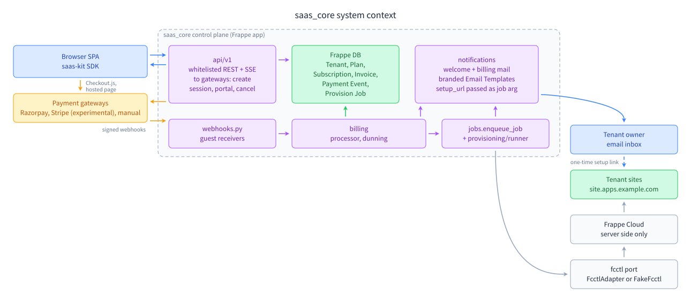
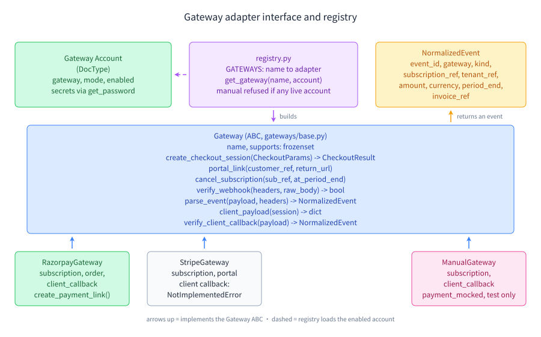
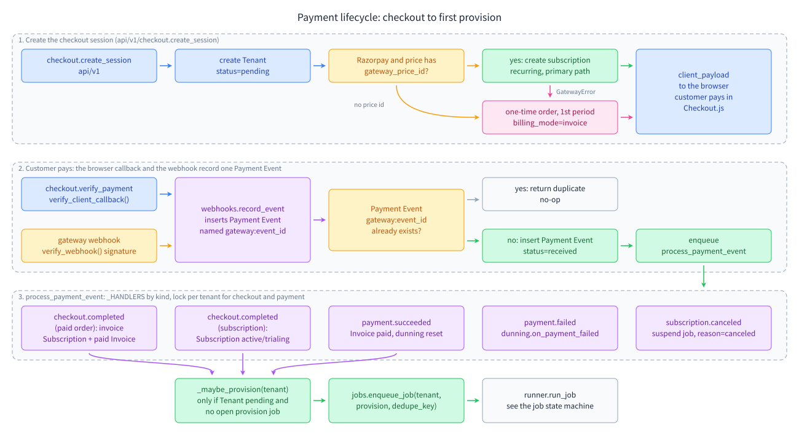
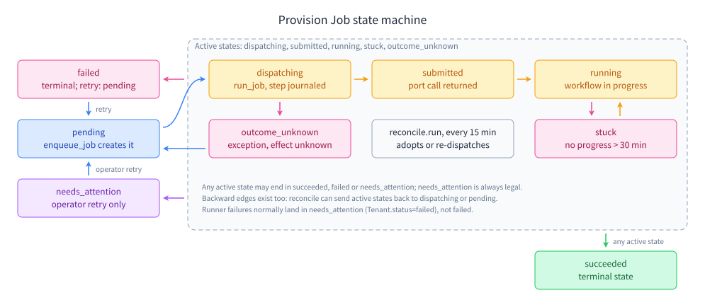
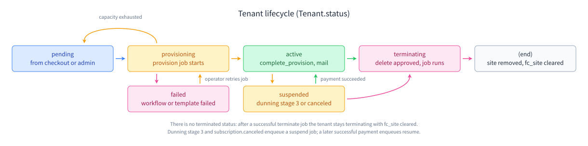
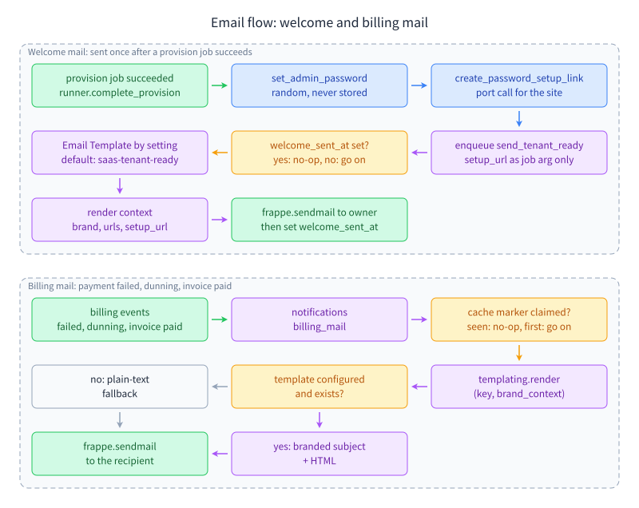
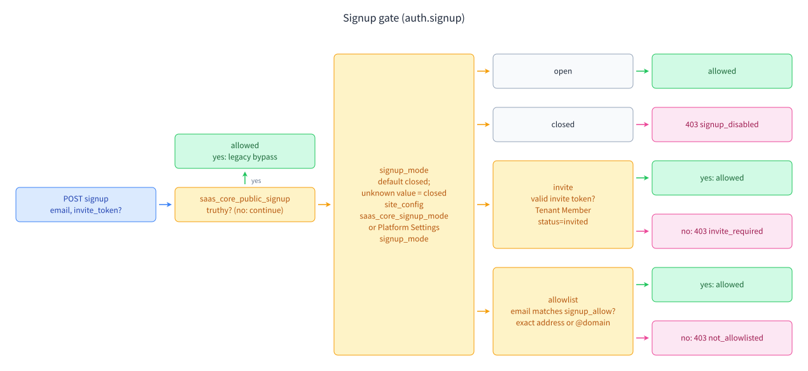

# saas_core architecture

Reader-oriented overview of the control plane. The module-by-module worker contract (DocType fields, interfaces) lives in [../ARCHITECTURE.md](../ARCHITECTURE.md); this page explains how the pieces behave at runtime. Each diagram is an SVG in [`assets/`](assets/).

All diagrams were written from the code in `saas_core/` (`webhooks.py`, `gateways/`, `billing/`, `provisioning/`, `jobs.py`, `notifications/`, `config/`, `api/v1/`).

## 1. System context

The browser SPA only ever calls the saas_core API. Payment gateways call back into saas_core. Frappe Cloud is reached only from the server, through the `fcctl` port (`provisioning/stores.py: FcctlAdapter`, imported lazily); `saas_core_fake_fcctl` swaps in an in-memory fake for dev and tests.



## 2. Gateway adapter interface and registry

`gateways/base.py` defines the `Gateway` ABC. `gateways/registry.py` holds the `GATEWAYS` map and `get_gateway(name, account=None)`, which loads the enabled `Gateway Account` (secrets via `get_password`) and builds the adapter. The `manual` gateway is the mock-payment adapter; the registry refuses it in `live` mode.



Event `kind` is one of `checkout.completed`, `payment.succeeded`, `payment.failed`, `subscription.canceled`, `subscription.updated`, `refund`, `ignored`. Browser callback (`verify_client_callback`) and payment links (`create_payment_link`) are optional capabilities (`client_callback`, `payment_link`): a gateway that does not declare one is answered 422 at the callback endpoint and skipped for invoice renewals. Today Razorpay, manual and fake declare `client_callback`; Razorpay and fake declare `payment_link` (used for the invoice fallback and renewals); Stripe (experimental) declares neither.

## 3. Payment lifecycle

Checkout (`api/v1/checkout.create_session`) creates a `pending` Tenant, then asks the gateway for a session. For Razorpay the primary path is a recurring **subscription**; if no `gateway_price_id` is mapped or the subscription call fails with a `GatewayError`, it falls back to a one-time **order** for the first period (`billing_mode=invoice`, response `fallback: "invoice"`), and later periods are billed as **Payment Link invoices** (`processor.issue_due_invoices`, daily).

Two inbound paths record the same event: the gateway webhook (`webhooks.ingest`) and the browser callback (`checkout.verify_payment`). Both call `webhooks.record_event`, which inserts a `Payment Event` named `<gateway>:<event_id>`; a second insert is detected and returns `duplicate`, so only the first one enqueues `billing.processor.process_payment_event`.



Notes that are easy to miss:

- A `checkout.completed` **webhook** for a subscription only activates the Subscription; provisioning is triggered when the verified browser callback (`paid`) or a trial is present, or by a later `payment.succeeded`. Whichever path arrives second hits the status guard and only calls `_maybe_provision`.
- `_maybe_provision` is idempotent: it takes a cache lock, skips unless `Tenant.status == "pending"`, and skips if a non-terminal `provision` job already exists.
- `process_payment_event` marks the event `processing`, then `processed`, `ignored` (unknown kind) or `failed` (re-raised; `attempts` incremented). Already `processed`/`ignored` events return immediately.
- Failed payments feed `billing/dunning.py`: stages at 1, 3, 7, 14 days after the first failure; stage 3 enqueues a `suspend` job (`reason=dunning`), a later successful payment enqueues `resume`.

## 4. Provisioning state machine (Provision Job)

`jobs.enqueue_job` creates a `Provision Job` in `pending` and enqueues `runner.run_job`. Transitions are enforced by `provisioning/ports.check_transition`; moving to `needs_attention` is always allowed. `succeeded` has no outgoing edges; `failed` can only go back to `pending` (retry). Job `kind` values: provision, suspend, resume, change_plan, terminate, backup, restore.



- Terminal states (`TERMINAL_STATES`): `succeeded`, `failed`. Note that runner failures normally land in `needs_attention` (with `Tenant.status=failed`), not `failed`.
- **Resume safety**: before dispatching a provision, the runner asks the port `find_workflow(workflow_id)`. A finished workflow is adopted, a failed one fails the job, a running one is resumed by id.
- `reconcile.run` (every 15 min) adopts or redispatches `provision` jobs in active states; `terminate`/`backup`/`restore` with unknown outcome are moved to `needs_attention` and never auto-retried; suspend/resume/change_plan are re-dispatched.
- Preflight capacity failure fails the job with the tenant returned to `pending` (event `job.capacity_exhausted`).
- `terminate` and `restore` require an executable two-person `Approval Request`.
- Each state change publishes `job.updated` / `job.step` through `events.publish` (consumed by the SSE endpoint).

## 5. Tenant lifecycle

`Tenant.status` is one of `pending`, `provisioning`, `active`, `suspended`, `terminating`, `failed`. There is no `terminated` status: after a successful terminate job the tenant stays `terminating` with `fc_site` cleared.



Other jobs that leave the status unchanged: `backup`, `restore` (approval gated), `change_plan` (refuses disk-shrinking downgrades).

## 6. Email flow

Two mail families exist. Both resolve the template name from settings and fall back when it is unset.



Branded templates are chosen with `<key>_email_template` settings, read by `config.get_setting` from site_config (`saas_core_<key>_email_template`) first:

| Setting key | Used for | Fallback if unset |
|---|---|---|
| `setup_email_template` | first mail, "Complete your setup": one-time set-password link only | Email Template `saas-tenant-setup` (fixture) |
| `welcome_email_template` | welcome, sent only after the tenant site reports setup complete (`tenants.setup_complete`); site URL and next steps, no link key | Email Template `saas-tenant-ready` (fixture) |
| `payment_failed_email_template` | payment failed | plain text |
| `dunning_email_template` | overdue notices | plain text |
| `invoice_email_template` | invoice paid | plain text |
| `password_reset_email_template` | password reset | Frappe standard reset mail |
| `admin_invite_email_template` | admin tenant invite | Frappe standard reset mail |

Branding variables come from `brand`, `brand_color`, `logo_url`, `logo_url_dark`, `support_email`, `console_url`, and `setup_link_expiry_hours` (default 24). The setup URL is never stored on the Tenant or logged, and the admin password is never mailed.

```bash
bench --site <site> set-config saas_core_welcome_email_template my-branded-welcome
```

**Two-step onboarding.** After provisioning the runner (a) generates a per-tenant `Tenant.setup_secret` (Password field), (b) writes `saas_setup_cp_url` and `saas_setup_cp_secret` (plus aliases from `saas_core_setup_config_prefixes`) into the tenant's site_config through the port (`set_site_config`), (c) sets a random Administrator password and (d) queues `welcome.send_tenant_setup` ("Complete your setup", sets `setup_email_sent_at`). When the owner finishes the tenant-side setup, the site POSTs `{site, completed_at}` to `/api/method/saas_core.api.v1.tenants.setup_complete` with header `X-Saas-Signature: sha256=<HMAC-SHA256(setup_secret, raw body)>`. The endpoint is guest-callable but fails with a uniform 401 `invalid_signature` for any bad MAC, unknown site or stale timestamp (older than 7 days). On success it stamps `Tenant.setup_completed_at` and queues `welcome.send_tenant_welcome` (`welcome_sent_at` guard, never sent before setup completes). The call is idempotent so tenant-side retries are harmless. `site_config` key for the CP URL: `saas_core_cp_url` (falls back to the site URL).

## 7. Signup gate modes

`api/v1/auth.signup` calls `_enforce_signup_gate`, which delegates to `config/signup.is_signup_allowed`. The mode comes from `saas_core_signup_mode` (site_config) or Platform Settings `signup_mode`; an unknown or missing value is `closed`. An explicitly truthy legacy `saas_core_public_signup` site_config key bypasses the gate.



The public config endpoint reports `signup_mode` and `public_signup` so a front end can hide the sign-up form when the gate is closed.
